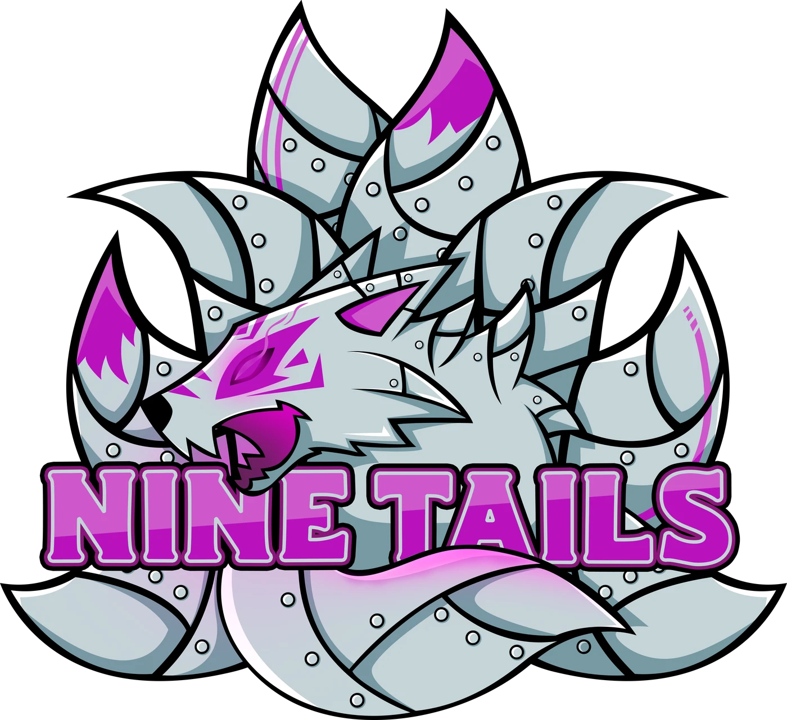
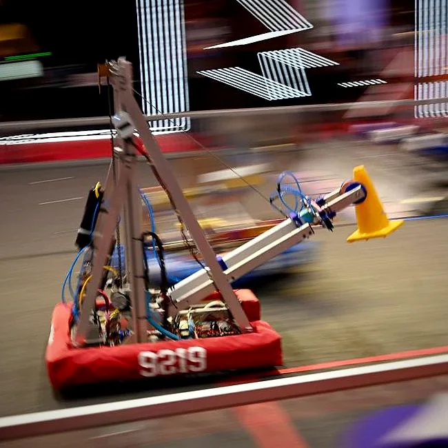
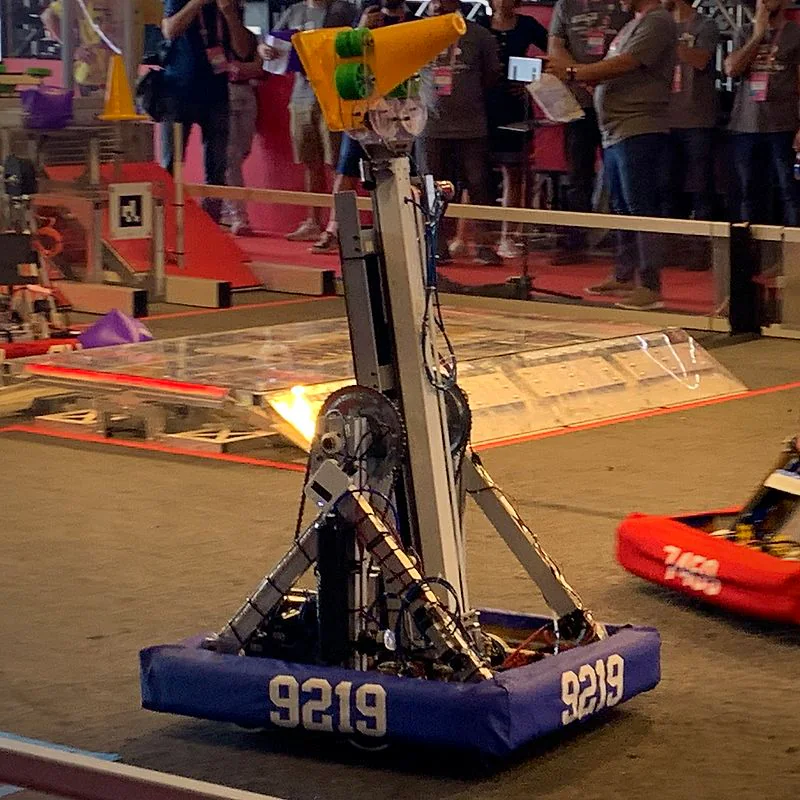
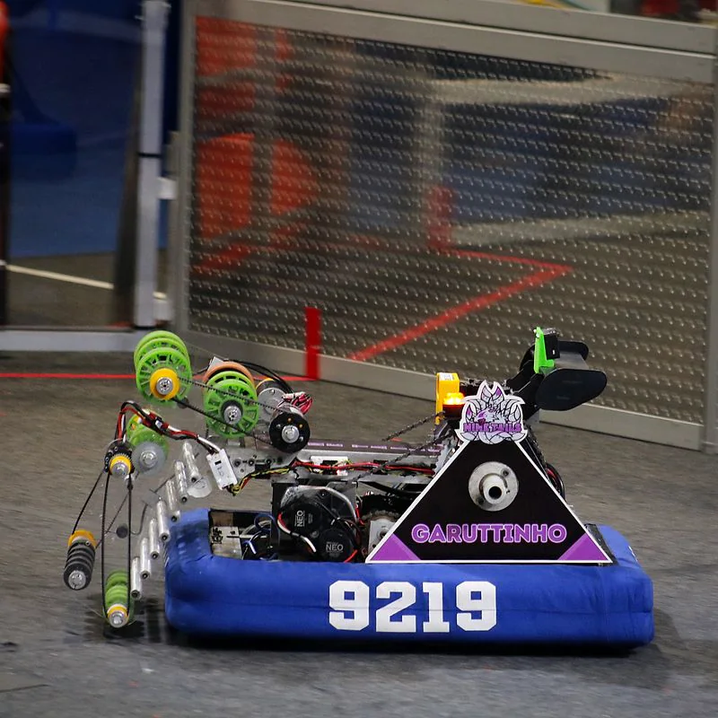
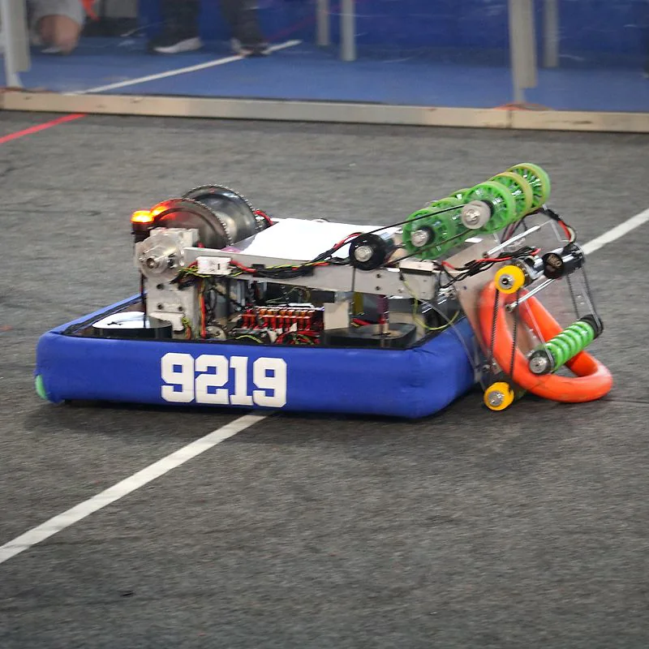
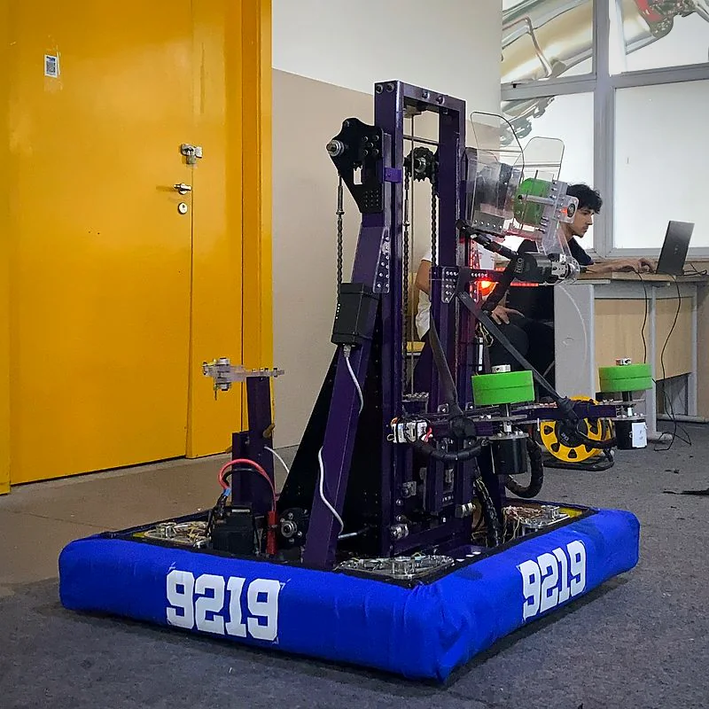
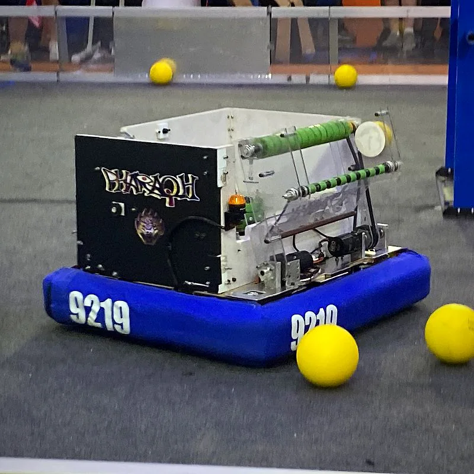
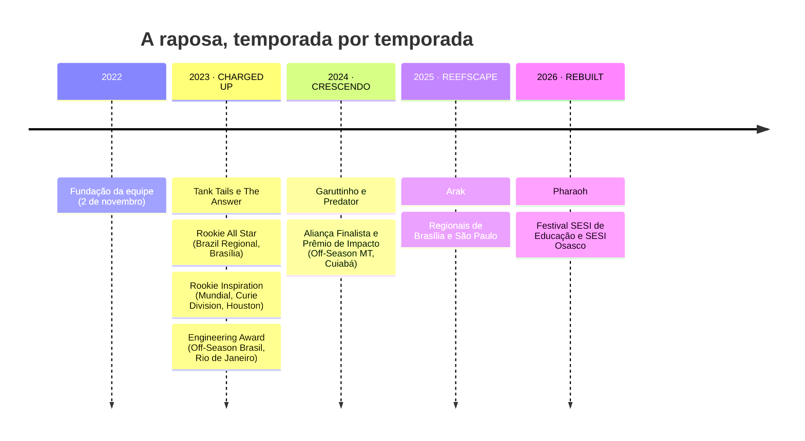
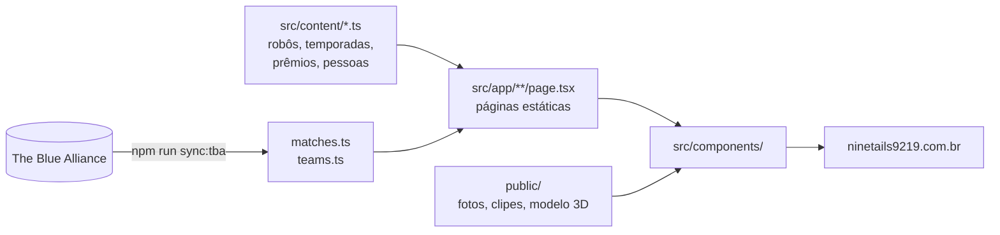

<div align="center">



# Nine Tails #9219

**Evolução constante desde 2022.**

Site oficial da equipe de FIRST Robotics Competition da Escola Firjan SENAI SESI Resende (RJ).

[](https://ninetails9219.com.br)
[](https://www.thebluealliance.com/team/9219)
[](https://www.instagram.com/ninetails9219/)


[O hangar](#-o-hangar) · [Linha do tempo](#-linha-do-tempo) · [O que tem no site](#-o-que-tem-no-site) · [Rodando](#-rodando) · [Como editar](#-como-editar) · [Arquitetura](#-arquitetura)

</div>

---

## 🦊 O hangar

Clique num robô para abrir a página dele no site.

<table>
  <tr>
    <td align="center" width="33%">
      <a href="https://ninetails9219.com.br/robots/tank-tails"></a><br />
      <b>Tank Tails</b> · 2023<br />
      <sub>Robô #1 · Tank drive</sub><br />
      <sub><i>O primeiro. O que levou a raposa até Houston.</i></sub>
    </td>
    <td align="center" width="33%">
      <a href="https://ninetails9219.com.br/robots/the-answer"></a><br />
      <b>The Answer</b> · 2023<br />
      <sub>Robô #2 · Rodas omnidirecionais</sub><br />
      <sub><i>A resposta, construída em menos de um mês.</i></sub>
    </td>
    <td align="center" width="33%">
      <a href="https://ninetails9219.com.br/robots/garuttinho"></a><br />
      <b>Garuttinho</b> · 2024<br />
      <sub>Robô #3 · Rodas omnidirecionais</sub><br />
      <sub><i>Agilidade para estrear como veterana.</i></sub>
    </td>
  </tr>
  <tr>
    <td align="center">
      <a href="https://ninetails9219.com.br/robots/predator"></a><br />
      <b>Predator</b> · 2024<br />
      <sub>Robô #4 · Swerve drive</sub><br />
      <sub><i>O primeiro swerve da raposa.</i></sub>
    </td>
    <td align="center">
      <a href="https://ninetails9219.com.br/robots/arak"></a><br />
      <b>Arak</b> · 2025<br />
      <sub>Robô #5 · Swerve drive</sub><br />
      <sub><i>L4 no autônomo. Níveis automatizados no controle.</i></sub>
    </td>
    <td align="center">
      <a href="https://ninetails9219.com.br/robots/pharaoh"></a><br />
      <b>Pharaoh</b> · 2026<br />
      <sub>Robô #6 · Swerve drive</sub><br />
      <sub><i>Um faraó para a temporada da arqueologia.</i></sub>
    </td>
  </tr>
</table>

## 🏆 Linha do tempo



<details>
<summary><b>📊 Os números da equipe</b></summary>

<br />

| | |
|---:|:---|
| **25.000+** | pessoas impactadas diretamente por ações STEAM |
| **6.222** | crianças no Nine Learns, em 5 escolas públicas de Resende |
| **55** | equipes em 16 países receberam o projeto Nine Learns |
| **2,6 mi** | pessoas alcançadas pelas nossas redes e ações |
| **122** | partidas oficiais, sincronizadas do The Blue Alliance |

<sub>Fonte: portfólio da equipe (fev/2024) e TBA. Os mesmos dados ficam em `src/content/site.ts`.</sub>

</details>

## 🗺️ O que tem no site

<details open>
<summary><b>Menu principal</b></summary>

| Página | Rota | O que tem |
|---|---|---|
| Início | `/` | Foto da equipe por temporada, explorador de temporadas, "neste dia" |
| Temporadas | `/seasons` | Um capítulo por jogo, com eventos, partidas e vídeos |
| Robôs | `/robots` | Tank Tails em 3D e o hangar em três vistas: **fichas**, **galeria** e **comparar** |
| Conquistas | `/awards` | Estante de troféus desenhados a partir dos troféus reais |
| Impacto | `/impact` | Nine Learns e as ações STEAM |
| Equipe | `/team` | Áreas da equipe e quem faz o quê |
| Apoie a equipe | `/sponsor` | Patrocinadores e como apoiar |

</details>

<details>
<summary><b>Menu "Mais"</b></summary>

| Página | Rota | O que tem |
|---|---|---|
| Museu da Raposa | `/museum` | O acervo da equipe, sala por sala, com passaporte de visita |
| Alumni | `/alumni` | Quem passou pela raposa e onde está hoje |
| Recordes e alianças | `/records` | As 122 partidas em números |
| Os pioneiros | `/pioneers` | O diário da primeira temporada |
| Viagens | `/travel` | Todas as competições, de Brasília a Houston |
| Glossário | `/glossary` | O vocabulário da FRC explicado |
| Kit da marca | `/brand` | Logos para baixar e curiosidades |
| Créditos | `/credits` | Autoria e licença de toda foto de terceiros |

</details>

<details>
<summary><b>🎮 Detalhes para procurar</b></summary>

<br />

- **A página 404 é um jogo.** O "404" é feito de centenas de peças de jogo numa quadra de FRC vista de cima. Um robô 9219 roda o **autônomo**; mexa o mouse, toque no campo ou use as setas e ele passa para o **teleoperado**. O placar conta as peças fora do lugar. Teste em [ninetails9219.com.br/qualquer-coisa](https://ninetails9219.com.br/qualquer-coisa).
- **Troca de página:** uma barra magenta corre no topo com o emblema da raposa na ponta.
- **Carregamento:** as nove caudas acendem uma de cada vez em volta do emblema.
- **Tema claro e escuro**, com a paleta fixa da equipe nos dois.
- **Busca** em todo o site, pelo botão do cabeçalho.
- **Reduzir movimento:** com a opção ligada no sistema, as animações param.

</details>

## 🚀 Rodando

```bash
npm install
npm run dev        # http://localhost:3000
npm run build      # build de produção (sincroniza com o TBA antes)
npm start          # serve o build
npm run sync:tba   # atualiza as partidas a partir do The Blue Alliance
```

<details>
<summary><b>🔑 Chave do The Blue Alliance</b></summary>

<br />

Para o `sync:tba` funcionar, crie `.env.local` com:

```env
TBA_API_KEY=...
```

A chave é gerada em [thebluealliance.com/account](https://www.thebluealliance.com/account). Na Vercel, cadastre a mesma variável.
Sem a chave, o build usa os dados que já estão no repositório.

</details>

## ✏️ Como editar

Quase tudo o que aparece no site é texto em `src/content/*.ts`. Abra a receita do que você quer fazer:

<details>
<summary><b>📸 Adicionar fotos</b></summary>

<br />

1. Exporte em `.webp` (qualidade ~82): no máximo **2560px** de largura para fotos grandes e **1800px** para as demais. Salve em `public/team/`.
   Fotos do iPhone (`.HEIC`) precisam ser convertidas antes.
2. Aponte o caminho no conteúdo:

   | Foto | Campo |
   |---|---|
   | Robô | `photo` em `src/content/robots.ts` |
   | Bastidores do robô | `backstage` em `src/content/robots.ts` |
   | Prêmio | `photo` em `src/content/awards.ts` |
   | Galeria da temporada | `teamPhotos` em `src/content/gallery.ts` |
   | Topo da home (equipe inteira, uma por temporada) | `heroTeamPhotos` em `src/content/gallery.ts` |

Sem foto, o site mostra um espaço reservado e o robô aparece como planta técnica.

</details>

<details>
<summary><b>🤖 Novo robô</b></summary>

<br />

Adicione um objeto em `src/content/robots.ts` (nome, ano, `seasonSlug`, tração, frase, competições e prêmios). Ele aparece
sozinho nas três vistas do hangar, na linhagem e ganha a página `/robots/<slug>`.

</details>

<details>
<summary><b>🏅 Novo prêmio</b></summary>

<br />

Adicione em `src/content/awards.ts`, escolhendo o desenho que corresponde ao troféu de verdade (`art`):

- `frc-plaque`: placa de madeira da FRC
- `sesi`: troféu do Festival SESI de Robótica
- `certificate`: certificado

Se o troféu tiver um formato novo, desenhe um componente em `src/components/graphics/Trophies.tsx` a partir de uma foto dele.

</details>

<details>
<summary><b>📅 Nova temporada</b></summary>

<br />

1. Adicione um objeto em `src/content/seasons.ts`.
2. Adicione os robôs em `src/content/robots.ts`.
3. Coloque as chaves do evento no TBA em `scripts/sync-tba.mjs` (`EVENT_SLUGS`) e em `src/content/allies.ts` (`matchEvents`).

</details>

> [!IMPORTANT]
> **A paleta é fixa**, com as cores da equipe. As temporadas se diferenciam pela foto real do jogo e pelo logo oficial, nunca
> pela cor. Toda foto de terceiros precisa de licença livre e de uma entrada em `src/content/credits.ts`, que aparece em `/credits`.

<details>
<summary><b>🎨 Cores e fontes</b></summary>

<br />

| Token | Claro | Escuro |
|---|---|---|
| `--brand` |  |  |
| `--accent` |  |  |
| `--fg` |  |  |
| `--bg` |  |  |

Títulos em **Oswald**, texto em **Manrope**. Os tokens ficam no `:root` de `src/app/globals.css`.

</details>

## 🧩 Arquitetura



<details>
<summary><b>📁 Onde fica cada coisa</b></summary>

<br />

| O quê | Onde |
|---|---|
| Textos e dados (temporadas, robôs, prêmios, pessoas, patrocinadores) | `src/content/*.ts` |
| Partidas e equipes (gerados pelo script, não editar à mão) | `src/content/matches.ts`, `src/content/teams.ts` |
| Pesquisa completa sobre a equipe (fonte dos dados) | `docs/PESQUISA.md` |
| Cores, fontes e utilitários visuais | `src/app/globals.css` (tokens no `:root`) |
| Páginas | `src/app/**/page.tsx` |
| Componentes | `src/components/` |
| Vistas do hangar (fichas, galeria, comparar) | `src/components/robots/HangarViews.tsx` |
| Jogo da página 404 | `src/components/brand/Field404.tsx` |
| Desenhos dos troféus | `src/components/graphics/Trophies.tsx` |
| Modelo 3D do Tank Tails | `public/models/tank-tails.glb` + `src/components/robots/TankTails3D.tsx` |
| Logos | `public/brand/` |
| Fotos da equipe | `public/team/` e `public/photos/` |
| Clipes em loop | `public/clips/` |
| Fotos dos jogos da FRC (com crédito e licença) | `public/seasons/` + `src/content/credits.ts` |

</details>

<details>
<summary><b>📝 Padrão de commit</b></summary>

<br />

Uma linha em inglês por assunto, com prefixo:

```text
feat: add sheet, gallery and table views to the robots hangar
fix: unify the omni drivetrain label on The Answer
docs: rewrite the README
```

</details>

---

<div align="center">


<sub>Feito na oficina da Nine Tails #9219 · Resende, RJ · <a href="mailto:ninetails9219@gmail.com">ninetails9219@gmail.com</a></sub>

</div>
