<div align="center">


# Nine Tails #9219

**Evolução constante desde 2022.**

Site oficial da equipe de FIRST Robotics Competition da Escola Firjan SENAI SESI Resende (RJ).<br />
Seis robôs, cinco troféus, 122 partidas e 6.222 crianças, contados com foto real e animação feita à mão.

[](https://ninetails9219.com.br)
[](https://www.thebluealliance.com/team/9219)
[](https://www.instagram.com/ninetails9219/)


[Tour](#-tour-pelo-site) · [Hangar](#-o-hangar) · [Linha do tempo](#-linha-do-tempo) · [Mapa](#%EF%B8%8F-mapa-do-site) · [Interações](#-todas-as-interações) · [Rodando](#-rodando) · [Como editar](#%EF%B8%8F-como-editar) · [Arquitetura](#-arquitetura)

<br />

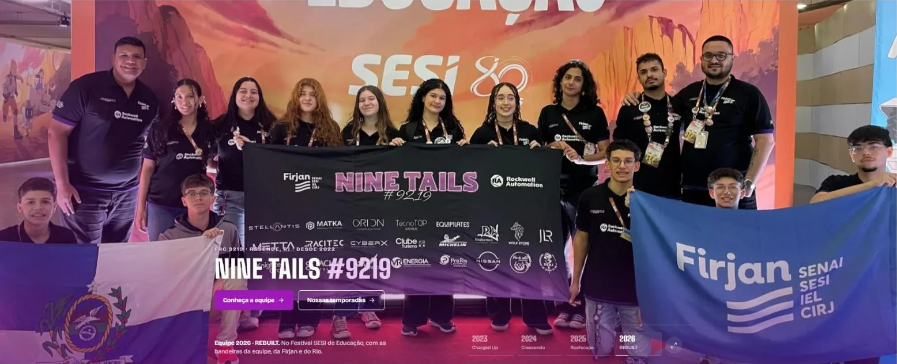

<sub>O topo da home troca a foto da equipe a cada temporada, com uma faixa roxa atravessando a tela.</sub>

</div>

---

## 🎬 Tour pelo site

<table>
  <tr>
    <td width="50%" valign="top">
      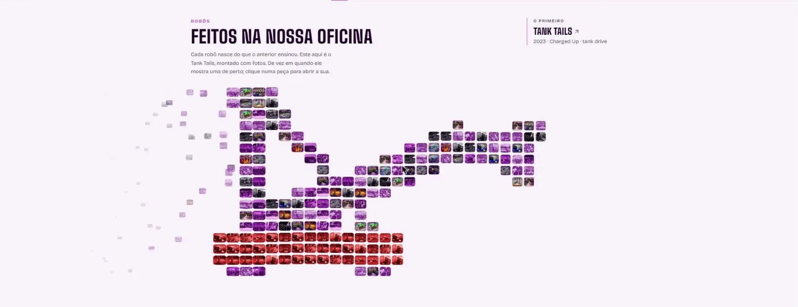
      <h3>O robô feito de fotos</h3>
      O topo de <code>/robots</code> é o <b>Tank Tails montado com 40 fotos da equipe</b>, cada uma com uma edição diferente
      (duotone roxo, retícula, saturada, jornal). Ele entra correndo, freia, fica "andando" com o braço subindo e descendo,
      e de tempos em tempos a câmera <b>mergulha numa foto</b>: uma cortina revela a original e aparece a legenda.
      Clique em qualquer peça para abrir a dela.
    </td>
    <td width="50%" valign="top">
      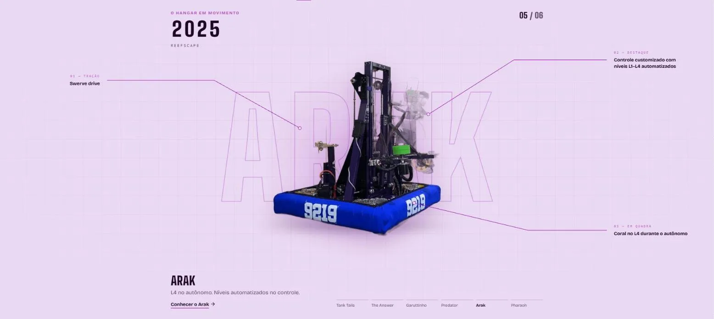
      <h3>O hangar em movimento</h3>
      Rolando a página, <b>cada robô atravessa a quadra</b>, do Tank Tails ao Pharaoh. Os robôs foram <b>recortados das fotos</b>,
      o nome aparece gigante e vazado atrás, as <b>linhas de anotação se desenham</b> até a tração, o destaque e a jogada
      de cada um, e o ano roda como um odômetro. Embaixo, um trilho com os seis nomes marca o progresso.
    </td>
  </tr>
  <tr>
    <td valign="top">
      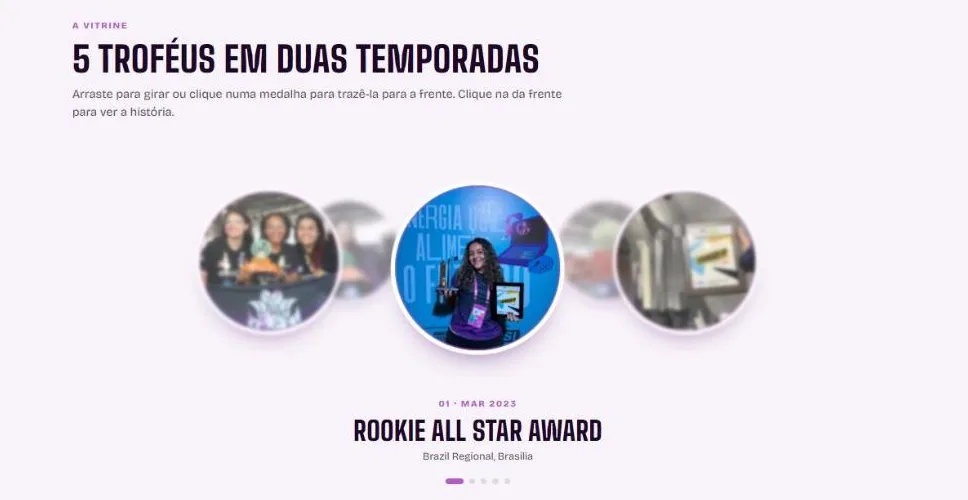
      <h3>A vitrine de troféus</h3>
      Os cinco prêmios viram <b>medalhas num anel 3D</b> que gira devagar sozinho. A da frente fica grande e nítida, as de trás
      encolhem e desfocam. Dá para <b>arrastar</b> com o mouse ou o dedo, clicar numa medalha para trazê-la para a frente
      e clicar na da frente para ir à história do prêmio.
    </td>
    <td valign="top">
      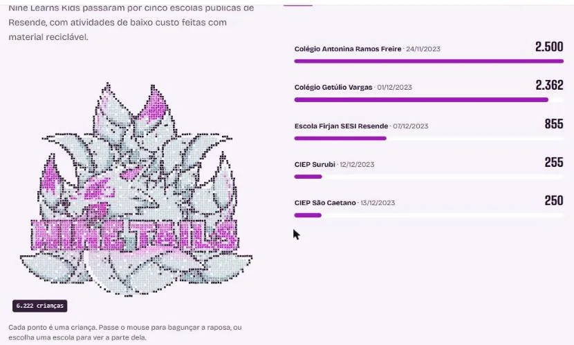
      <h3>6.222 crianças, 6.222 pontos</h3>
      No Nine Learns, <b>cada criança vira um ponto</b> e os pontos montam o emblema da raposa, chegando de baixo como a
      criançada entrando na escola. Cada escola é uma fatia do emblema: passe o mouse na lista e a parte dela acende.
      O cursor <b>espalha os pontos</b>, que voltam para o lugar.
    </td>
  </tr>
  <tr>
    <td valign="top">
      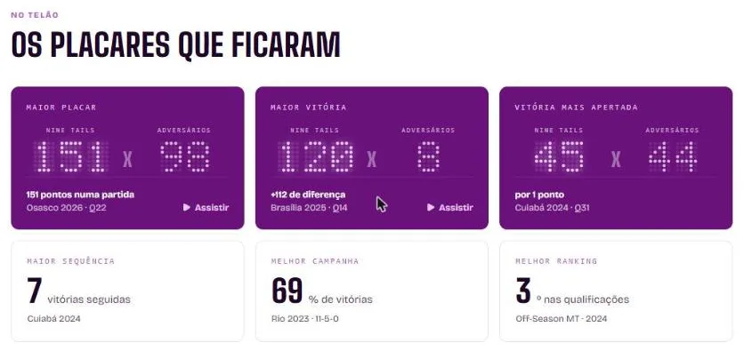
      <h3>O telão dos recordes</h3>
      Os maiores placares aparecem num <b>letreiro de LED 5×7</b>, como o telão da arena, acendendo ponto por ponto.
      Abaixo, as 122 partidas em ordem, um quadrado por partida: passe o mouse para ver o placar e clique para
      <b>assistir o vídeo</b> oficial.
    </td>
    <td valign="top">
      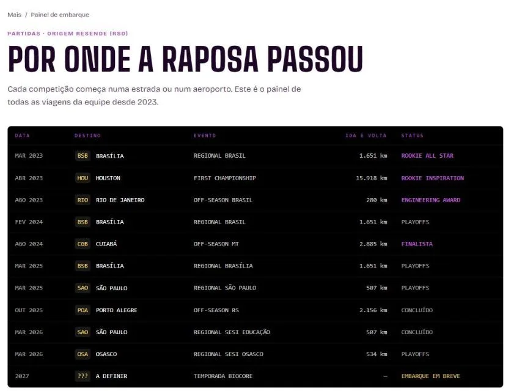
      <h3>O painel de embarque</h3>
      Todas as viagens num <b>painel de aeroporto</b>: as letras giram até parar no destino certo quando a linha aparece.
      Códigos de aeroporto, quilômetros de ida e volta e o status de cada viagem, como "Rookie Inspiration" ou
      "Embarque em breve".
    </td>
  </tr>
  <tr>
    <td valign="top">
      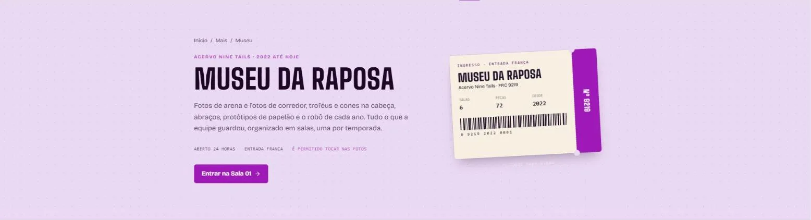
      <h3>O Museu da Raposa</h3>
      O acervo da equipe <b>sala por sala</b>, uma por temporada, com polaroids, molduras e peças em vitrine. As luzes
      <b>acendem quando você entra</b> numa sala, a planta na lateral marca onde você está, e o ingresso ganha um
      <b>carimbo</b> por sala. Com todas carimbadas, ele vira e mostra o certificado de visita.
    </td>
    <td valign="top">
      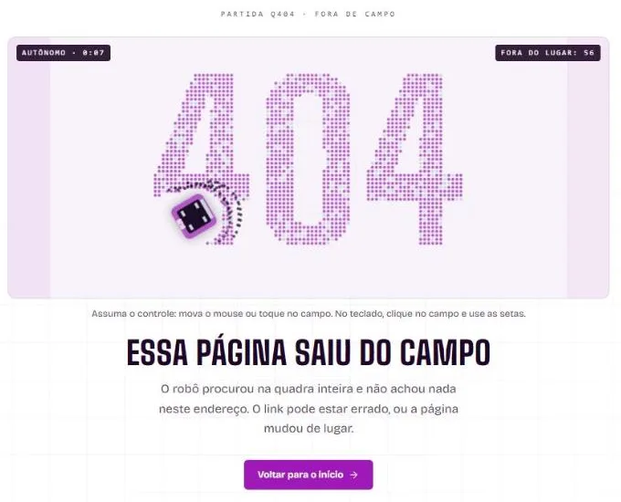
      <h3>A 404 é um jogo</h3>
      O "404" é feito de centenas de peças numa quadra vista de cima. Um robô 9219 roda o <b>autônomo</b>; mexa o mouse,
      toque no campo ou use as setas e ele passa para o <b>teleoperado</b>. O placar conta as peças fora do lugar.
      Teste em <a href="https://ninetails9219.com.br/qualquer-coisa">/qualquer-coisa</a>.
    </td>
  </tr>
</table>

## 🦊 O hangar

Clique num robô para abrir a página dele.

<table>
  <tr>
    <td align="center" width="33%">
      <a href="https://ninetails9219.com.br/robots/tank-tails"></a><br />
      <b>Tank Tails</b> · 2023<br />
      <sub>Robô #1 · Tank drive · <b>modelo 3D</b></sub><br />
      <sub><i>O primeiro. O que levou a raposa até Houston.</i></sub>
    </td>
    <td align="center" width="33%">
      <a href="https://ninetails9219.com.br/robots/the-answer"></a><br />
      <b>The Answer</b> · 2023<br />
      <sub>Robô #2 · Rodas omnidirecionais</sub><br />
      <sub><i>A resposta, construída em menos de um mês.</i></sub>
    </td>
    <td align="center" width="33%">
      <a href="https://ninetails9219.com.br/robots/garuttinho"></a><br />
      <b>Garuttinho</b> · 2024<br />
      <sub>Robô #3 · Rodas omnidirecionais</sub><br />
      <sub><i>Agilidade para estrear como veterana.</i></sub>
    </td>
  </tr>
  <tr>
    <td align="center">
      <a href="https://ninetails9219.com.br/robots/predator"></a><br />
      <b>Predator</b> · 2024<br />
      <sub>Robô #4 · Swerve drive</sub><br />
      <sub><i>O primeiro swerve da raposa.</i></sub>
    </td>
    <td align="center">
      <a href="https://ninetails9219.com.br/robots/arak"></a><br />
      <b>Arak</b> · 2025<br />
      <sub>Robô #5 · Swerve drive</sub><br />
      <sub><i>L4 no autônomo. Níveis automatizados no controle.</i></sub>
    </td>
    <td align="center">
      <a href="https://ninetails9219.com.br/robots/pharaoh"></a><br />
      <b>Pharaoh</b> · 2026<br />
      <sub>Robô #6 · Swerve drive</sub><br />
      <sub><i>Um faraó para a temporada da arqueologia.</i></sub>
    </td>
  </tr>
</table>

Cada robô tem uma página com ficha técnica, história, clipe em loop, comparação **oficina × arena** (arraste a divisória),
bastidores e a **fita de partidas** de cada evento. O Tank Tails tem um **modelo 3D** que repete a jogada da Charged Up:
o braço sobe, o telescópio estica, a garra solta o cone na haste. Arraste para girar.

## 🏆 Linha do tempo

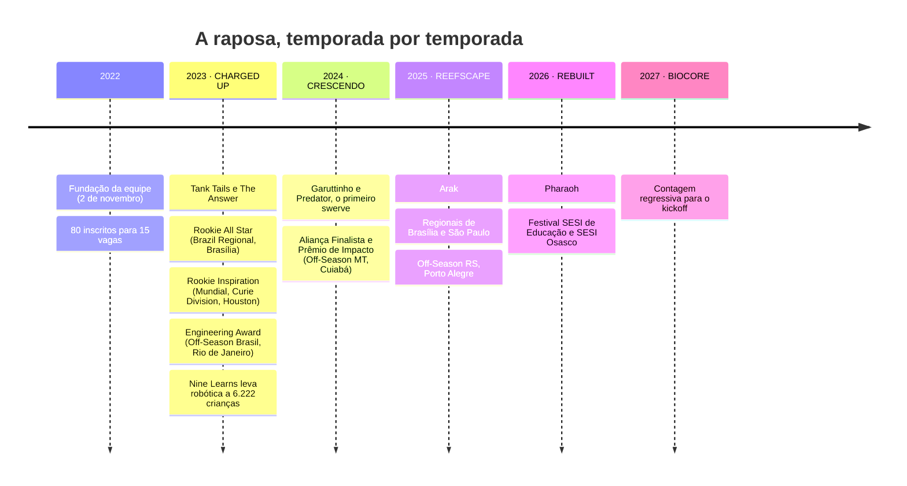

<details>
<summary><b>📊 Os números da equipe</b></summary>

<br />

| | |
|---:|:---|
| **25.000+** | pessoas impactadas diretamente por ações STEAM |
| **6.222** | crianças no Nine Learns, em 5 escolas públicas de Resende |
| **55** | equipes em 16 países receberam o projeto Nine Learns |
| **2,6 mi** | pessoas alcançadas pelas nossas redes e ações |
| **122** | partidas oficiais em 11 eventos, sincronizadas do The Blue Alliance |
| **56** | vitórias, com maior placar de **151** pontos |

<sub>Fonte: portfólio da equipe (fev/2024) e TBA. Os mesmos dados ficam em `src/content/site.ts`.</sub>

</details>

## 🗺️ Mapa do site

<details open>
<summary><b>Menu principal</b></summary>

<br />

| Página | Rota | O que tem |
|---|---|---|
| **Início** | `/` | Foto da equipe por temporada, "neste dia", explorador de temporadas, bastidores, troféus, impacto, robôs, Tank Tails em 3D e patrocinadores |
| **Temporadas** | `/seasons` | Um capítulo por jogo, com a foto, o ano gigante, a logo oficial e o melhor do ano |
| ↳ temporada | `/seasons/[slug]` | Campanha em tabela, partidas evento a evento, robôs e galeria |
| ↳ competição | `/competitions/[key]` | Placar geral, partidas com vídeo, fotos e prêmios de cada evento |
| **Robôs** | `/robots` | Robô em mosaico, hangar em movimento e o hangar em três vistas: **fichas**, **galeria** e **tabela** |
| ↳ robô | `/robots/[slug]` | Ficha técnica, história, clipe, oficina × arena, bastidores e partidas |
| **Conquistas** | `/awards` | Vitrine com o anel de medalhas e a história de cada prêmio, com troféu em 3D |
| **Impacto** | `/impact` | Um capítulo por projeto, o emblema de 6.222 pontos, o Nine Learns pelo mundo |
| **Equipe** | `/team` | A história, o porquê do nome, as quatro áreas, a oficina em loops e os marcos |
| **Apoie a equipe** | `/sponsor` | Patrocinadores e como apoiar |

</details>

<details>
<summary><b>Menu "Mais"</b></summary>

<br />

| Página | Rota | O que tem |
|---|---|---|
| **Museu da Raposa** | `/museum` | O acervo sala por sala, com planta, luzes, carimbos e certificado de visita |
| **Alumni** | `/alumni` | A turma girando em órbita em volta do emblema, com crachá de cada um |
| **Recordes** | `/records` | Placares no letreiro de LED, as 122 partidas em ordem e o melhor de cada temporada |
| **Os pioneiros** | `/pioneers` | O diário da primeira temporada, com uma linha do tempo que se preenche na leitura |
| **Viagens** | `/travel` | O painel de embarque com todas as competições, de Brasília a Houston |
| **Glossário** | `/glossary` | O vocabulário da FRC explicado |
| **Créditos** | `/credits` | Autoria e licença de toda foto de terceiros |

</details>

> [!NOTE]
> As rotas antigas, em português (`/robos`, `/temporadas`, `/museu`...), redirecionam para as novas. Links velhos continuam funcionando.

## ✨ Todas as interações

<details open>
<summary><b>🧭 Em todo o site</b></summary>

<br />

| | |
|---|---|
| **Busca** | `Ctrl K` ou o botão do cabeçalho. Acha robô, temporada, prêmio, competição e termo, sem ligar para acento ("cuiaba" acha "Cuiabá"). |
| **Troca de página** | Uma barra roxa corre no topo com o emblema da raposa na ponta. |
| **Carregamento** | As nove caudas acendem uma de cada vez em volta do emblema. Só CSS. |
| **Fotos ampliadas** | Qualquer foto com o ícone de ampliar abre inteira, sem corte. Fecha com `Esc`, no X ou clicando fora. |
| **Termos da FRC** | Palavras sublinhadas com pontinhos ("swerve", "alliance", "autônomo") mostram a explicação no hover e levam ao glossário. |
| **Topos com foto** | Abrem com um zoom lento e descem mais devagar que o texto ao rolar. |
| **Cards clicáveis** | Todos têm o mesmo hover: sobem um pouco, a borda acende e a seta anda. |
| **Clipes em loop** | Funcionam como GIF leve: tocam só quando aparecem na tela e têm botão de pausa. |
| **Números** | Contam até o valor final quando aparecem na tela. |

</details>

<details>
<summary><b>🏠 Início</b></summary>

<br />

- **Equipe por temporada:** o topo troca a foto da equipe inteira (2023 a 2026) com uma faixa roxa que atravessa a tela. Pausa com o mouse em cima e dá para escolher o ano nas abas.
- **Neste dia:** quando uma competição faz aniversário por estes dias, aparece um cartão lembrando, com quantos anos ela completa.
- **Explorador de temporadas:** abas por ano, com a foto real do jogo, a logo oficial e o que a equipe fez.
- **Bastidores:** mosaico de fotos com legenda no hover.
- **Tank Tails em 3D:** o primeiro robô repetindo a jogada da Charged Up. Arraste para girar.

</details>

<details>
<summary><b>🤖 Robôs</b></summary>

<br />

- **Robô em mosaico:** clique numa peça para abrir a foto. O botão no canto pausa a animação.
- **Hangar em movimento:** a rolagem comanda tudo, do robô atravessando a quadra às linhas de anotação.
- **Três vistas do hangar:** fichas grandes, galeria com inclinação 3D e brilho no hover, ou tabela para comparar. O site lembra a escolha.
- **Oficina × arena:** arraste a divisória para comparar o robô em construção e em campo. Funciona com teclado.
- **Fita de partidas:** uma barra por partida, com altura igual aos pontos. Hover mostra o placar, clique abre o vídeo.
- **Planta técnica:** robô sem foto aparece como um rascunho de caderno visto de cima, com os módulos da tração dele.

</details>

<details>
<summary><b>🏅 Conquistas, impacto e temporadas</b></summary>

<br />

- **Anel de medalhas:** gira sozinho (mais devagar com o mouse em cima). Arraste, clique para trazer à frente ou use os pontinhos.
- **Troféus em 3D:** cada troféu balança quando aparece e depois acompanha o mouse, para ser olhado de lado.
- **Capítulos de impacto:** um capítulo por projeto, com índice fixo marcando onde você está. A descrição **acende palavra por palavra** conforme você rola e a foto abre em blocos, como um tabuleiro.
- **Emblema de pontos:** passe por uma escola na lista para acender a fatia dela. O mouse espalha os pontos.
- **Contagem regressiva** para o kickoff da BIOCORE (9 de janeiro de 2027).
- **Fotos das temporadas** reveladas como uma cortina subindo.

</details>

<details>
<summary><b>🏛️ Museu, alumni, recordes e viagens</b></summary>

<br />

- **Museu:** salas que acendem na entrada, planta lateral no desktop (barra de salas no celular), ingresso com carimbo por sala e certificado quando todas estão carimbadas.
- **Alumni:** a turma em órbita. Passe o mouse por alguém para pausar e ver o nome, clique para ir ao crachá.
- **Recordes:** letreiro de LED, trilha das 122 partidas com a maior sequência de vitórias destacada por um anel.
- **Viagens:** letras de painel de aeroporto girando até o destino. O texto final já vem no HTML, então funciona sem JavaScript.
- **Pioneiros:** a linha lateral se preenche com a cor da equipe conforme a leitura avança.

</details>

> [!TIP]
> **Reduzir movimento:** com a opção ligada no sistema, as animações param ou viram troca simples. O hangar mostra um robô
> de cada vez, o emblema já aparece montado, os clipes começam pausados e o anel não gira sozinho.

## 🚀 Rodando

```bash
npm install
npm run dev        # http://localhost:3000
npm run build      # build de produção (sincroniza com o TBA antes)
npm start          # serve o build
npm run lint       # ESLint
npm run sync:tba   # atualiza as partidas a partir do The Blue Alliance
```

> [!WARNING]
> Se uma cor ou animação nova não aparecer no `npm run dev`, reinicie o servidor. O modo de desenvolvimento às vezes segura
> o `globals.css` antigo. O build de produção não tem esse problema.

<details>
<summary><b>🔑 Chave do The Blue Alliance</b></summary>

<br />

Para o `sync:tba` funcionar, crie `.env.local` com:

```env
TBA_API_KEY=...
```

A chave é gerada em [thebluealliance.com/account](https://www.thebluealliance.com/account). Na Vercel, cadastre a mesma variável.
Sem a chave, o build usa os dados que já estão no repositório. Quando o TBA tem um evento novo da equipe, o script avisa no terminal.

</details>

## ✏️ Como editar

Quase tudo o que aparece no site é texto em `src/content/*.ts`. Abra a receita do que você quer fazer:

<details>
<summary><b>📸 Adicionar fotos</b></summary>

<br />

1. Exporte em `.webp` (qualidade ~82): no máximo **2560px** de largura para fotos grandes e **1800px** para as demais. Salve em `public/team/`.
   Fotos do iPhone (`.HEIC`) precisam ser convertidas antes.
2. Aponte o caminho no conteúdo:

   | Foto | Campo |
   |---|---|
   | Robô | `photo` em `src/content/robots.ts` |
   | Robô recortado (hangar em movimento) | `cutout` em `src/content/robots.ts`, `.webp` com fundo transparente |
   | Bastidores do robô | `backstage` em `src/content/robots.ts` |
   | Prêmio (medalha e história) | `photo` em `src/content/awards.ts` |
   | Projeto de impacto | `photo` em `src/content/impact.ts` (sem foto, fica o espaço "Foto em breve") |
   | Peça do museu | `rooms` em `src/content/museum.ts`, com moldura `tela`, `moldura`, `vitrine`, `polaroid` ou `fita` |
   | Galeria da temporada | `teamPhotos` em `src/content/gallery.ts` |
   | Topo da home (equipe inteira, uma por temporada) | `heroTeamPhotos` em `src/content/gallery.ts` |

Sem foto, o site mostra um espaço reservado e o robô aparece como planta técnica.

</details>

<details>
<summary><b>🎞️ Clipes em loop</b></summary>

<br />

Salve o vídeo curto, sem som, em `public/clips/<nome>.mp4` e um pôster com o mesmo nome em `.webp`. Use com o componente `Loop`:

```tsx
<Loop src="/clips/arak.mp4" label="O Arak testando o swerve na oficina" aspect="aspect-[4/5]" />
```

Prefira vídeo a `.gif`: fica até 10 vezes menor e com cor de verdade.

</details>

<details>
<summary><b>🤖 Novo robô</b></summary>

<br />

Adicione um objeto em `src/content/robots.ts` (nome, ano, `seasonSlug`, tração, frase, destaques, competições e prêmios). Ele aparece
sozinho no hangar em movimento, nas três vistas e ganha a página `/robots/<slug>`. Para o hangar em movimento, inclua o `cutout`.

</details>

<details>
<summary><b>🏅 Novo prêmio</b></summary>

<br />

Adicione em `src/content/awards.ts` com a foto da equipe recebendo o prêmio (ela vira a medalha do anel) e escolha o
desenho que corresponde ao troféu de verdade (`art`):

- `frc-plaque`: placa de madeira da FRC
- `sesi`: troféu do Festival SESI de Robótica
- `certificate`: certificado

Se o troféu tiver um formato novo, desenhe um componente em `src/components/graphics/Trophies.tsx` a partir de uma foto dele.

</details>

<details>
<summary><b>📅 Nova temporada</b></summary>

<br />

1. Adicione um objeto em `src/content/seasons.ts`.
2. Adicione os robôs em `src/content/robots.ts`.
3. Coloque as chaves do evento no TBA em `scripts/sync-tba.mjs` (`EVENT_SLUGS`) e em `src/content/allies.ts` (`matchEvents`).
4. Abra uma sala nova no museu, em `src/content/museum.ts`.

</details>

> [!IMPORTANT]
> **A paleta é fixa**, com as cores oficiais da equipe. As temporadas se diferenciam pela foto real do jogo e pelo logo
> oficial, nunca pela cor. Toda foto de terceiros precisa de licença livre e de uma entrada em `src/content/credits.ts`, que aparece em `/credits`.

<details>
<summary><b>🎨 Identidade visual</b></summary>

<br />

Um tema só, claro, com as duas cores oficiais da equipe.

| Token | Cor | Uso |
|---|---|---|
| `--brand` |  | Roxo principal: botões, faixas, destaques |
| `--accent` |  | Roxo secundário: links, rótulos, detalhes |
| `--tint` |  | Lavanda: topos sem foto, palco do hangar, entrada do museu |
| `--surface` |  | Blocos e faixas alternadas |
| `band` |  | Faixas roxas escuras (telão, certificado) |
| `--fg` |  | Texto |

Títulos em **Big Shoulders**, condensados e em caixa alta. Texto em **Bricolage Grotesque**. Os tokens ficam no `:root`
de `src/app/globals.css` e viram classes do Tailwind (`bg-tint`, `text-accent`...) pelo `@theme`.

</details>

## 🧩 Arquitetura

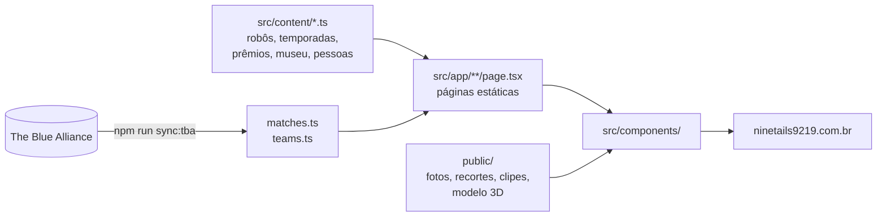

Tudo é gerado estático no build (Next.js 16 com Cache Components). As animações pesadas, como o mosaico, o emblema de
pontos e a 404, são **canvas 2D sem dependências**. As ligadas à rolagem escrevem direto no estilo pelo `ref`, sem
re-renderizar o React a cada quadro. A única biblioteca 3D é o three.js, carregada só onde o Tank Tails aparece.

<details>
<summary><b>📁 Onde fica cada coisa</b></summary>

<br />

| O quê | Onde |
|---|---|
| Textos e dados (temporadas, robôs, prêmios, museu, pessoas, patrocinadores) | `src/content/*.ts` |
| Partidas e equipes (gerados pelo script, não editar à mão) | `src/content/matches.ts`, `src/content/teams.ts` |
| Pesquisa completa sobre a equipe (fonte dos dados) | `docs/PESQUISA.md` |
| Cores, fontes e animações globais | `src/app/globals.css` |
| Páginas | `src/app/**/page.tsx` |
| Robô em mosaico | `src/components/robots/MosaicRobot.tsx` + `mosaic/engine.ts` |
| Hangar em movimento | `src/components/robots/RobotShowcase.tsx` |
| Vistas do hangar (fichas, galeria, tabela) | `src/components/robots/HangarViews.tsx` |
| Modelo 3D do Tank Tails | `public/models/tank-tails.glb` + `src/components/robots/TankTails3D.tsx` |
| Anel de medalhas e troféus | `src/components/graphics/` |
| Capítulos e emblema do impacto | `src/components/impact/` |
| Museu (salas, planta, ingresso, carimbos) | `src/components/museum/` |
| Letreiro de LED e trilha de partidas | `src/components/records/` |
| Jogo da página 404 | `src/components/brand/Field404.tsx` |
| Componentes base (Loop, Reveal, Tilt, Term, PhotoViewer...) | `src/components/ui/` |
| Logos | `public/brand/` |
| Fotos da equipe e recortes dos robôs | `public/team/` e `public/photos/` |
| Acervo do museu | `public/museu/` |
| Clipes em loop | `public/clips/` |
| Fotos dos jogos da FRC (com crédito e licença) | `public/seasons/` + `src/content/credits.ts` |
| Imagens deste README | `docs/readme/` |

</details>

<details>
<summary><b>📝 Padrão de commit</b></summary>

<br />

Uma linha em inglês por assunto, com prefixo:

```text
feat: add a scroll-driven robot showcase with cut-out robots and callouts
fix: align season photos with their text and soften the photo gradients
docs: rewrite the README with a tour of every page and interaction
```

</details>

---

<div align="center">


<sub>Feito na oficina da Nine Tails #9219 · Resende, RJ · <a href="mailto:ninetails9219@gmail.com">ninetails9219@gmail.com</a></sub>

</div>
